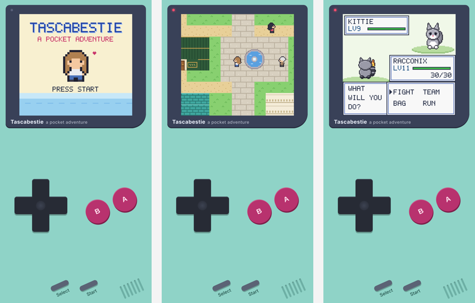

# Tascabestie

A small retro monster-catching game you play on your phone, held upright like an old handheld console. It runs in the browser: no installation, no account.

The game is available in English (`index.html`) and Italian (`index-it.html`).

## How to play

Open `index.html` in a browser, or visit the page published with GitHub Pages. For the Italian version, open `index-it.html` (or add `/index-it.html` to the published address). On a phone the game fills the screen like a pocket console.

| Button | On a phone | On a computer |
|---|---|---|
| D-pad | on-screen D-pad | arrow keys or W A S D |
| A (talk, confirm) | A button | Z or J |
| B (cancel, run) | B button | X or K |
| Start (menu) | Start button | Enter |
| Select (Bestiary) | Select button | Shift |

On iPhone, open the game in Safari and choose "Add to Home Screen" to play full screen. Your progress is saved in the browser you play with.

## Features

- 56 Tascabestie to catch and evolve, across 12 types
- Turn-based battles with up to 4 moves per creature, shared experience and new moves learned as they level up
- A complete adventure: a town, a pine forest, a train station, a creek, a hilltop village, a gym and a rival
- A bag with Potions and Tascaballs, a supermarket, a PC storage box and a Bestiary to complete
- Automatic and manual saving
- Original graphics and sound, generated entirely in code

## How it's built

Each language version is a single file, with HTML, CSS and JavaScript. It uses no external libraries or image files: sprites, maps and sound effects are drawn and generated in code. The only external resource is the frame's font, loaded from Google Fonts.

## Publish it with GitHub Pages

1. Upload the repository files to GitHub.
2. Go to **Settings → Pages**.
3. Under **Build and deployment**, choose **Deploy from a branch**, then the `main` branch and the `/ (root)` folder.
4. After a minute the game will be live at `https://<your-username>.github.io/<repository-name>/`.

## Disclaimer

Tascabestie is a fan-made hobby project and is not affiliated with Nintendo, Game Freak, The Pokémon Company or any other video game brand. All names, creatures, graphics and sounds are original.

## Authors

Created by Diego Febbe, Leonardo Mazzoni.

## License

Released under the MIT License: see the [LICENSE](LICENSE) file.
